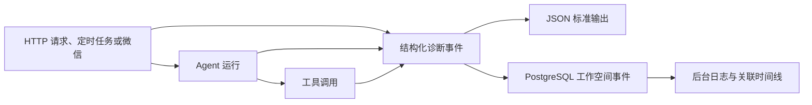

# 系统日志管理设计

首版已接入「后台管理 → 系统日志」，对应项目阶段七的运行观测和故障定位。部署时先应用迁移 `0021`。页面从迁移后的新事件开始展示。

前端评审可打开[系统日志交互原型](prototypes/system-logs.html)。页面使用模拟诊断事件，支持列表筛选、时间线和诊断编号复制。

## 目标和现状

用户在问答或连接器页面看到错误后，可以复制诊断编号。管理员在当前工作空间查询失败发生的时间、步骤、错误分类和耗时。一次工具失败应可追溯到发起请求、Agent 运行及工具调用，并能区分本地参数错误、授权失败、网络失败、上游业务拒绝和响应解析失败。

应用向标准输出写入 JSON，诊断事件使用 `diagnostic` 字段。HTTP 中间件生成 `X-Request-ID`，问答和工具事件记录 `request_id` 与 `run_id`。`tool_calls` 保存执行状态和错误码，审批事件及 `admin_audits` 保存各自的业务审计。

## 存储方案

| 方案 | 优点 | 代价与适用阶段 |
|---|---|---|
| 标准输出外加 PostgreSQL 诊断事件表 | 复用现有数据库和工作空间鉴权，可直接提供后台查询界面 | 需限制事件量和索引数量，适合当前本地开发和小规模部署 |
| 统一日志平台 | 适合多实例汇集、跨服务检索和告警 | 需要额外部署和访问控制，适合并行 Worker 或多服务部署后评估 |

首版采用 PostgreSQL 保存精选诊断事件。完整运行输出通过 JSON 日志查询，管理、审批和工具审计由现有业务接口提供。

## 采集和关联

- HTTP 请求带服务端生成的 `request_id`。诊断记录已验证空间的接口异常，以及新问答或手动定时问答的受理事件。HTTP 访问日志由应用中间件统一生成，路径使用路由模板，例如 `/api/runs/{run_id}`。查询字符串不会进入访问日志或诊断事件。
- 问答启动时传递可信空间、`request_id` 和 `run_id`。子 Agent、模型请求及工具执行继承运行关联，工具事件带 `tool_call_id`。定时问答保留任务执行标识，微信入口保留渠道类别。非 HTTP 工作不要求存在 HTTP 请求编号。
- 首版采集运行开始和终态、模型终态和重试、工具终态、主动连接检查、定时问答及微信投递。SSE 心跳、高频轮询和成功的普通 HTTP 请求仅沿用标准输出。
- 连接器失败在适配器内区分 `request_validation`、`auth`、`transport`、`upstream_business` 和 `response_validation`。诊断详情仅允许预定义字段，例如上游 HTTP 状态、上游数字业务码、响应校验规则和重试次数。
- 业务状态先按原有流程提交，诊断事件通过有界队列由独立异步会话批量写入。写入失败或队列满时仍可从标准输出排查，同时记录丢弃量和失败次数。应用退出时尝试限时清空队列。

## 数据和接口

新增追加写入的 `system_log_events`。核心字段为 `id`、`occurred_at`、`workspace_id`、`level`、`component`、`event`、`outcome`、`error_code` 和 `duration_ms`。关联字段为可空的 `request_id`、`run_id`、`tool_call_id`、`connector_key`、`tool_name` 和调度任务执行标识。可选 `details` 受事件类型白名单约束，写入前校验类型和长度，诊断文案从事件与错误码模板生成。

- 建立工作空间与时间索引，以及请求、运行、工具调用 ID 的按空间查找索引。以 `(occurred_at, id)` 倒序游标分页，支持时间、级别、模块、连接器、结果、错误码和完整诊断编号筛选。
- `GET /api/admin/system-logs` 返回脱敏列表，`GET /api/admin/system-logs/{id}` 返回允许展示的详情。同一详情可通过关联 ID 找到相关事件。默认查询最近 24 小时，每页 50 条，上限 100 条，普通查询时间窗上限 30 天。
- 诊断事件默认保留 30 天，可用 `EA_SYSTEM_LOG_RETENTION_DAYS` 配置为 1 至 365 天。每小时按批次清理过期记录，审批与管理审计保留策略独立。后台的普通筛选仍以最近 30 天为上限。

## 页面和权限

- 在「后台管理 → 系统日志」可按时间、模块、结果和级别筛选，也可输入诊断编号、关联编号或完整错误码。列表显示时间、来源、事件、结果、耗时和诊断编号。详情抽屉显示脱敏诊断、同一次执行的时间线和关联编号。
- 问答的工具失败信息可复制工具调用 ID，日志查询接受该 ID。在「连接器 → ima → 我的账号」可主动检查当前成员的个人绑定。知识库和笔记分别报告状态与诊断编号，成功查到零条属于连接成功。
- 服务端依据当前会话和空间成员关系授权，工作空间管理员只看到当前空间的脱敏事件。会话正文、工具业务结果和审批详情继续走现有接口及资源权限。请求没有可信空间时，只进入部署端日志，由运维人员查看。
- 日志入库前使用字段白名单。密钥、令牌、Cookie、连接字符串、对话文本、知识库标题和内容、原始工具参数以及上游响应体均不进入诊断事件。

## 验收

- 在独立 PostgreSQL 测试库走真实问答、工具审计及日志查询接口。用 ima 字段异常的测试响应验证 HTTP 200、业务码 0 和响应校验阶段，以及请求、运行和工具调用 ID 的关联。
- 验证工作空间隔离、普通成员权限、游标分页、保留期清理及诊断写入故障降级。测试凭证、私有问题和上游原始响应均未出现在诊断响应中。
- ima 个人连通性检查的集成用例验证真实登录、个人绑定、零结果成功和上游失败分类。上游响应使用测试传输。集中日志平台与告警可按部署规模评估。
